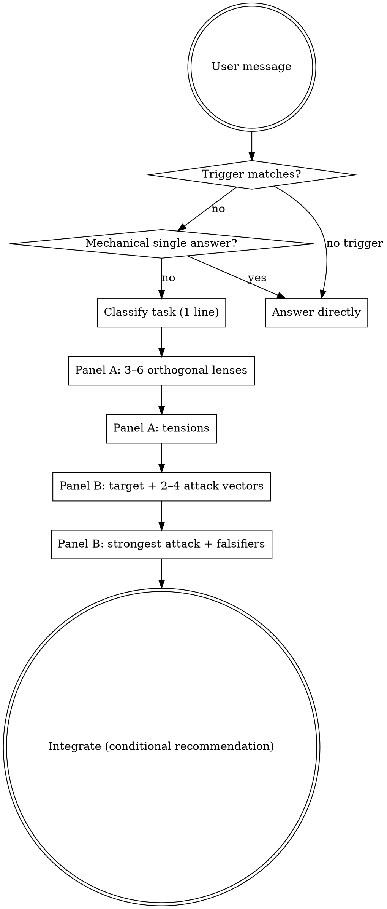

<SUBAGENT-STOP>
If you were dispatched as a subagent for a **narrow, purely mechanical** task (single correct answer, no tradeoffs) and the parent task did not ask for multiple perspectives, skip this skill and execute the assignment.
</SUBAGENT-STOP>

<EXTREMELY-IMPORTANT>
When this skill applies, you **do not** get to answer with one blended “default” take and call it done. You must **run both panels** (or explicitly skip per **When to skip**, or **one panel only** if the user explicitly requests that) before the final answer.

**Non-negotiables:**
- **Panel A** and **Panel B have different jobs.** If Panel B reads like “more stakeholders,” you failed Panel B.
- Panel A lenses must be **orthogonal**. Panel B attack vectors must be **orthogonal** to each other and **not** duplicate Panel A tensions as polite rephrases.
- **Do not fake consensus.** If two concerns stay incompatible after analysis, say so.
- **No stereotype theater.** Lenses and attacks are reasoning allocations, not caricatured identities.
- **User instructions override this skill.** Output shape, depth, panel count, and labels yield to explicit user requests.
</EXTREMELY-IMPORTANT>

## Instruction priority

1. **User’s explicit instructions** (message, project rules, output format) — highest
2. **This skill** — where the user did not specify otherwise
3. **Default helpful assistant habits** — lowest (including “single smooth answer”)

## Skill type

**Flexible.** Lens count, attack-vector count, headings, and “council only” / “red cell only” adapt to context. **Rigid** elements: two distinct panel roles, orthogonal lenses, orthogonal attacks, honest tradeoffs, no manufactured agreement.

# Perspective ensemble (variance from the mean)

## The rule

If **any** trigger in **When to apply** matches, you must **either** run **The procedure** (both panels by default) **or** follow **When to skip** with a one-line justification. Half measures (one vague “on the other hand”) are not compliance.

## Why this exists

Models compress toward **high-probability, middle-of-the-road** completions. This skill **widens the distribution on purpose** in **two modes**:
- **Council**: force **incompatible legitimate concerns** into the room (tradeoffs).
- **Adversarial**: assume **hostile reality** (misuse, bad luck, wrong assumptions) and **try to break** the plan—optimism bias lives here if anywhere.

## Two panels (do not merge)

| Panel | Job | Failure mode to avoid |
|-------|-----|------------------------|
| **A — Council** | Map real tradeoffs; separate tensions from noise; constructive counter-moves. | Everyone agreeing too easily; fake balance. |
| **B — Adversarial (red cell)** | Stress-test: assumptions, incentives, fragility, abuse, pre-mortem. **Attack** the proposal or the leading option. | Sounds like a snarky council; generic negativity; repeating Panel A with a rude tone. |

## When to apply

Apply when **any** of these is true:

- Problem is under-specified, strategic, or has multiple defensible approaches.
- “Correct” is insufficient: UX, ops, security, incentives, ethics, maintenance, politics of adoption.
- User signals divergence, challenge, or doubt: “what am I missing?”, “push back”, “other lenses”, “who would disagree?”, devil’s advocate, pre-mortem, red team, falsify, steelman the opposition.
- User uses the **activator** (or close variant): *Who would be a good group of people to help with this? What would they say?*

## When to skip

Skip the full ensemble **only** when:

- The task is **purely mechanical** with **one right answer** (syntax, stated fact retrieval, fixed one-step transform), **or**
- The user **explicitly** asks for a short single-take answer and breadth would violate their constraint.

**One panel only:** If the user explicitly asks for **only** red-team / adversarial **or** **only** council / tradeoffs, run that panel and state you skipped the other per request.

When skipping entirely: answer directly. **Do not** add artificial debate.

## Intellectual sources (not personas to perform)

Borrow **methods**, not celebrity voices:

| Source | What to steal |
|--------|----------------|
| Decision / risk | Premortems, reversibility, failure modes |
| Adversarial / security | Misuse, lazy operators, “how does this break?” — **Panel B’s home turf** |
| Product / org reality | Incentives, adoption cost, who maintains, who pays |
| Craft (pick as needed) | a11y, performance, IA, API ergonomics—match the artifact |
| Ethics / equity | When people are impacted: harm, exclusion, deception |
| Facilitation | Keep disagreement legible |

## The procedure

### Panel A — Council (tradeoff exploration)

1. **One-line classification** of the task (what kind of problem this is).
2. **Pick 3–6 lenses** tailored to *this* task. Prefer **tension** over headcount. Mix dimensions such as: ship vs safety, local simplicity vs global consistency, new-user clarity vs power-user speed, build cost vs ops cost, best case vs worst case.
3. **Per lens**, state: **primary concern** → **specific flag** on the user’s plan → **constructive counter-move** (not nagging alone).
4. **Name 2–3 real tensions** (A vs B) where choosing one actually sacrifices the other.

### Panel B — Adversarial (red cell)

5. **Target of attack** (one sentence): the user’s stated proposal, or—if none—the strongest implicit commitment in their message. If Panel A picked a frontrunner, you may attack **that**—say so explicitly.
6. **Pick 2–4 attack vectors** orthogonal to each other and **not** redundant with Panel A’s tension list (if an overlap is unavoidable, **go deeper**: mechanism, timeline, who defects first).
7. **Per vector**: **vulnerability or hidden assumption** → **failure scenario** (concrete) → **mitigation or probe** (experiment, guardrail, metric, rollback—**actionable**).
8. **Strongest line of attack**: one tight paragraph—if you wanted to sink this plan, **where** do you press?
9. **Falsifiers / early warnings**: what observable signals would tell you Panel B was right to worry?

### Close

10. **Recommendation (conditional)** (if appropriate): integrate **both** panels—**choice**, **because**, **what would revise the call**. Preserve irreducible dissent. Do not “average” Panel B away.

## Output shape (default)

Obey the user if they specify a format. Otherwise use **two top-level panels**:

```markdown
## Panel A — Council
- **[Lens]**: concern → flag → counter-move
- ...

## Tensions (unavoidable tradeoffs)
- … vs …: …

## Panel B — Adversarial (red cell)
- **Attack target**: …
- **[Vector]**: vulnerability → failure scenario → mitigation/probe
- ...

## Strongest attack (single paragraph)
…

## Falsifiers / early warnings
- …

## Recommendation (conditional)
- **Choice**: …
- **Because**: …
- **Would revise if**: …

## Open questions / cheap tests
- …
```

## Red flags

Thoughts that mean **STOP**—you are about to smuggle the mean back in:

| Thought | Reality |
|---------|---------|
| “I’ll add one caveat paragraph” | That is not ensemble variance. Run the procedure or skip formally. |
| “Panel B can repeat Panel A with attitude” | **No.** Panel B must add **pressure**, not **paraphrase**. |
| “The answer is obvious” | Obvious to whom? If triggers fired, obviousness is often shared blind spot. |
| “More perspectives = more words” | Orthogonal beats long. Panel B stays **tight**. |
| “I should resolve the tension for them” | Name the tradeoff; only collapse it if the user asked you to decide. |
| “Consensus will reassure the user” | **Do not manufacture agreement.** |
| “Adversarial = mean” | **Specific** beats **harsh**. Attacks must be **falsifiable** and **grounded**. |

## Flow



## Activator phrase

Users may paste:

> Who would be a good group of people to help with this? What would they say?

Treat as a **strong trigger** unless the user contradicts it in the same message.
